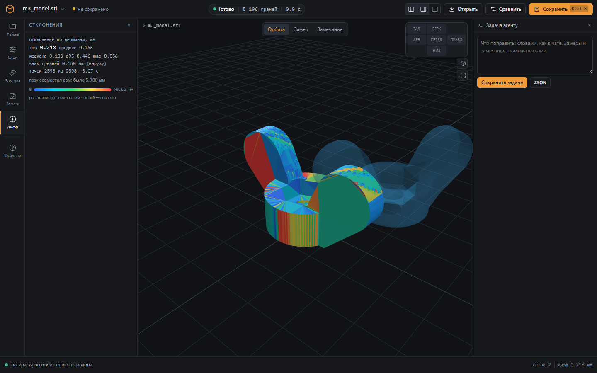
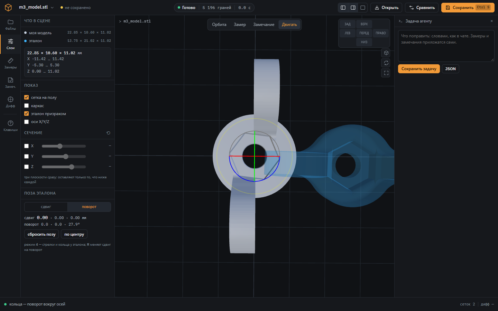
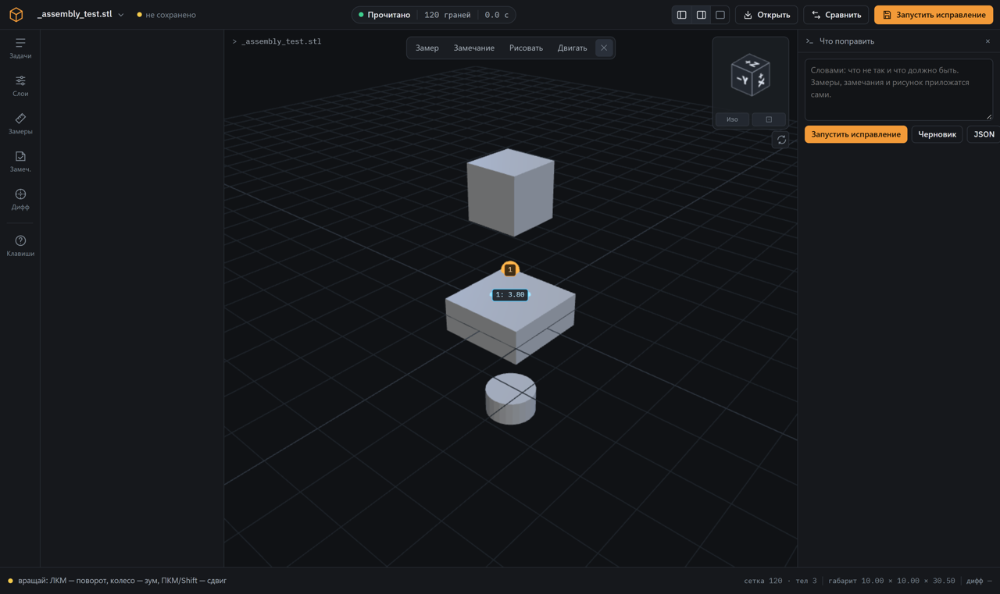
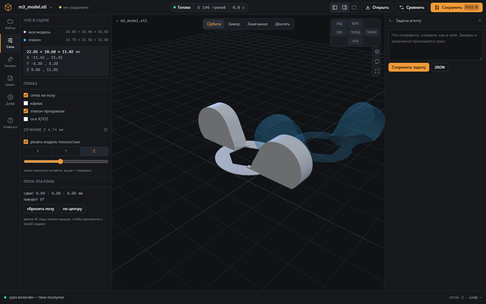

# stl-reverse-modeling

Инструменты обратной разработки по STL: замерить чужую деталь и **подобрать параметры
параметрической модели** так, чтобы её сетка совпала с эталоном.

Никаких «на глаз по чертежу»: параметры ищутся численно, метрика — расстояние между
поверхностями, совмещение (поза) пересчитывается на каждой сборке.

Ключевое свойство: **инструмент не знает, что за деталь перед ним**. Имена параметров
берутся из самой модели, границы — из `min`/`max` (или из `--margin`), допуск мешера
задаётся флагом. Ни одного имени вроде `NUT_AF` в коде нет.

## Интерфейс

Сделан по образцу SOMA: тёмная тема, верхняя панель 44 px, рейл 60 px, панель слева 272 px,
сцена, док справа 300 px, строка состояния 40 px, IBM Plex Sans/Mono. Токены цветов и метрики
сняты с её интерфейса, код свой — стили и разметка не скопированы.



Что можно делать мышью, без командной строки:

| Действие | Как |
|---|---|
| открыть сетку | «Открыть» (`Ctrl+O`), имя файла в шапке или перетащить STL в окно — второй файл становится эталоном |
| навигация | ЛКМ — поворот, колесо — зум, ПКМ/Shift — сдвиг, `F` — вписать, `1` — изо, кнопка облёта — автовращение |
| вид по грани | видовой кубик справа сверху: тянется мышью, клик по грани `+X/−X/+Y/−Y/+Z/−Z` ставит вид строго по оси (угол 12°, чтобы грани не «убегали»), «Изо» возвращает перспективу |
| разбор после загрузки | приходит сам: грани, тела, габарит, объём, площадь, замкнутость — шапка и панель «Слои» |
| замер | режим `Замер` (`2`), два клика по поверхности — расстояние и разложение по осям, `◎` — подлететь к замеру |
| замечание | режим `Замечание` (`3`), клик по месту и комментарий в панели «Замеч.» |
| рисовать по модели | режим `Рисовать` (`5`): вести мышью по поверхности — линия ляжет на деталь (видна в проекции), слой «рисунок» гасится в «Что в сцене» |
| срез | панель «Слои» → «Сечение»: три плоскости X/Y/Z сразу, у каждой свой ползунок; `⟲` в шапке снимает все |
| разнести сборку | панель «Слои» → «Разнесение»: ось X/Y/Z и доля 0…1, тела разъезжаются по шагам — видно сопряжения; на однотельной детали пишет «тело одно» |
| слои | «Что в сцене»: показ модели, эталона и рисунка — чекбоксы, габарит и метрики рядом |
| приложить эталон | режим `Двигать` (`4`): у эталона появляется гизмо — стрелки по осям, `R` — кольца поворота; «по центру» прикладывает по габаритам, «сбросить позу» обнуляет сдвиг и поворот |
| сравнение | «Сравнить»: сервер сам совмещает позу (ICP) и красит по отклонению |
| отмена | `Ctrl+Z` / `Ctrl+Shift+Z` — замеры, замечания, штрихи, сдвиг, срез |
| задача агенту | док справа «Что поправить»: текст, замеры, замечания и рисунок прикладываются сами; `Ctrl+S` — черновик, `Ctrl+Enter` — «Запустить исправление» (задача уходит в `tasks/task-<дата>.json` со статусом `queued`) |
| вернуться к задаче | рейл «Задачи»: список сохранённых, клик — поднимает модель, эталон, замеры, замечания, штрихи, позу и срез |

Срез включается плоскостями, а не разрезом геометрии: `renderer.localClippingEnabled` и
`material.clippingPlanes` — до трёх плоскостей одновременно, сетка не режется и обратно
собирается мгновенно. Разнесение режет сетку на тела по связности вершин (union-find с
допуском 0.001 мм) и разводит их вдоль оси; для детали из одного тела шаг просто отключается.
Штрихи рисунка хранятся как точки на поверхности — они переживают поворот камеры и уходят в
задачу. Поза эталона (сдвиг и поворот) уходит туда же вместе с замерами.







## Как запускать

Один раз: `viewer\install.cmd` — прав администратора не нужно, повторный запуск безопасен.
Ставит три вещи:

- **автозапуск при входе** — ярлык в `Startup`, сервер поднимается скрыто, без окна консоли;
- **сторож** в планировщике `STL Viewer (watchdog)` — раз в 5 минут проверяет порт 9131
  и поднимает сервер, если тот упал или его убили;
- **ярлык «STL Viewer» на рабочем столе** — открывает просмотрщик отдельным окном
  (Chrome `--app`), без вкладок и адресной строки.

Дальше нужен только ярлык: сервер живёт сам, терминал и Hermes ему не нужны, перезапуск
Hermes и браузера он переживает. Лог — `logs/server.log`, остановить — `viewer\stop.cmd`
(сторож вернёт его через 5 минут; совсем убрать — `schtasks /Delete /TN "STL Viewer (watchdog)"`).

Без установки — как раньше: `python viewer/server.py --port 9131 --root <каталог>` и открыть
`http://127.0.0.1:9131/`.

---

## Что внутри

| Файл | Назначение |
|---|---|
| `scripts/mesh_report.py` | замеры и сверка сеток: `--compare`, `--ransac`, `--levels`, `--png` |
| `scripts/fit_params.py` | автоподбор параметров модели по эталонному STL |
| `scripts/test_fit_universal.py` | самотест подбора на посторонней детали (истина известна) |
| `scripts/mesh_compare.py` | быстрый diff двух сеток |
| `templates/soma_part_example.py` | шаблон модели: контракт `param()` + `add_part()` |
| `examples/m3-butterfly/` | живой пример: M3-барашек, регрессионный гейт, пробы |
| `docs/playbook.md` | весь накопленный опыт: какие грабли и почему (полный текст) |
| `viewer/server.py` | локальный просмотрщик: отдать страницу, принять STL, сравнить две сетки |
| `web/` | интерфейс: раскладка и токены сняты с SOMA, вращение, замеры, замечания, срез плоскостью, перетаскивание эталона, отмена, раскраска по отклонению (`three` и шрифты IBM Plex лежат рядом, офлайн) |
| `viewer/install.cmd` | ставит приложение: автозапуск, сторож, ярлык (Windows, без админа) |
| `viewer/ensure.cmd` | поднимает сервер, если порт 9131 свободен (зовётся ярлыком и сторожем) |
| `viewer/stop.cmd` | остановить сервер, не выключая автозапуск |
| `web/icon.ico` | иконка приложения и ярлыка |

---

## Установка

```bash
python -m venv venv
venv/Scripts/pip install -r requirements.txt     # Linux/macOS: venv/bin/pip
```

Проверено на Python 3.12.15, cadquery 2.8.0, trimesh 5.2.1, numpy 2.5.4, scipy 1.18.1.

## Быстрый старт

Замерить эталон:

```bash
python scripts/mesh_report.py part.stl --json rep.json --png slices.png
```

Сверить свою модель с эталоном:

```bash
python scripts/mesh_report.py part.stl --compare model.stl --png diff.png --json rep.json
```

Подобрать параметры (главное):

```bash
python scripts/fit_params.py --model model.py --ref part.stl \
    --params W,D,T --mode both --samples 3000 --maxfev 150 \
    --csv fit.csv --json fit.json
```

`--apply` запишет найденные числа в `model.py`. Без него модель не трогается вообще
(сборка идёт с копии в `%TEMP%`), а числа лежат в `fit.json` — глазами посмотреть и решить.

## Просмотрщик


Смотреть деталь, мерить её руками и оставлять замечания агенту — без блендера и без браузера
с интернетом.

```bash
python viewer/server.py --open                       # http://127.0.0.1:9131
python viewer/server.py --root C:/Users/boot8/cad    # показать все STL из папки
```

На Windows проще двойной щелчок по `viewer/start.cmd` (сам найдёт venv, откроет браузер,
показывает и репозиторий, и папку `cad`).

Слева список STL: кнопка **моя** грузит сетку как модель, **эталон** — как полупрозрачную
подложку. Файл можно просто перетащить в окно.

| Что | Как |
|---|---|
| вращение | ЛКМ — поворот, колесо — зум, ПКМ/Shift — сдвиг, `F` — вписать в экран |
| режимы | `1` орбита, `2` замер, `3` замечание |
| замер | клик по точке, клик по второй — расстояние и Δx/Δy/Δz в правой панели |
| замечание | клик по проблемному месту + текст, у каждого пина свой ракурс (кнопка ◎) |
| сравнение | «сравнить с эталоном» — раскраска по расстоянию до эталона (синий = совпало, красный = максимум); позу совмещает сам через `rigid_align`, так что эталон из чужой библиотеки можно брать как есть |
| виды | изо / спереди / сверху / сбоку, галочки сетки, каркаса и полупрозрачного эталона |

Кнопка «сохранить задачу» пишет JSON в `tasks/task-<дата>.json`: обе сетки, габариты, все
замеры с координатами, замечания с ракурсами и цифры сравнения. Дальше в чате достаточно
сказать «посмотри задачу» — агент читает файл и правит модель по координатам, а не по
описанию «ну там справа чуть-чуть».

Ссылку можно открывать сразу с сетками: `?model=путь/к/модели.stl&ref=путь/к/эталону.stl`,
плюс `&compare=1` (сразу раскрасить) и `&mode=measure|pin`. `&selftest=1` прогоняет
самопроверку интерфейса — кликает по сцене, мерит, ставит пин, сравнивает и пишет итог в
заголовок окна.

Сравнение без совмещения врёт убедительно: эталон из чужой библиотеки стоит в других
координатах, и вместо отклонения формы выходит расстояние между позами (на барашке —
5.98 мм там, где форма расходится на 0.22). Поэтому `/api/compare` сначала зовёт
`rigid_align` из `scripts/fit_params.py`, а в цифрах пишет, сколько было до совмещения.

Работает офлайн: `three@0.169.0` лежит в `web/vendor/`, сборщик и npm не нужны. В списке
только `.stl`; другие форматы откроются, если добавить лоадер в `web/app.js`.

## Контракт модели

`fit_params.py` понимает три вида файлов:

1. **SOMA** — `param(name, value, ...)` + `add_part()`;
2. **CadQuery** — функция `build()` / `make()` / `model()`, возвращающая `Workplane`;
3. **простой модуль** — переменная `BODY` / `SHAPE` / `PART` / `SOLID` с телом.

Имена в `--params` должны совпадать с именами параметров в модели: подбор пишет новые
числа в файл и пересобирает через `build_stl()`.

---

## Что даёт на практике

Посторонняя деталь (пластина с нецентрированной бобышкой, истина `32 × 22 × 4.6`, бобышка `9.2`):

| Параметр | Промах |
|---|---|
| `W` | 0.008 мм |
| `D` | 0.007 мм |
| `T` | 0.001 мм |
| `BOSS_D` (5 % площади детали) | 0.106 мм |

rms по поверхности 0.0121 мм, ~7 минут, `model.py` после прогона побайтово цел.

Барашек M3 (настоящий STL, 3600 треугольников): `HUB_H` 0.035, `NUT_AF` 0.005,
`NUT_DEPTH` 0.049, `WING_Y0` 0.007 мм, rms 0.0093 — но это на **синтетическом** эталоне,
построенном из заведомо известных чисел. На реальной сетке `NUT_DEPTH` и `WING_Y0`
уезжают, потому что форма модели беднее сетки (плоское крыло против скруглённого,
раструб гнезда не воспроизведён). Это ограничение формы, а не поиска.

## Четыре вещи, которые решают всё

1. **`--mode sweep` — разведка, `--mode both` — ответ.** Свип сходится линейно: каждая
   пара «поза → проход» отрезает фиксированную долю окна. На посторонней детали шёл
   `0.667 → 0.52 → 0.33 → 0.18 → 0.10 → 0.070 → 0.049` и упёрся в точность сетки
   (истина на той же метрике — `0.0049`), а параметры недоползали: `W` промах 0.204.
   Финальный `least_squares` от точки минимума даёт `0.049 → 0.012` по rms и `0.204 → 0.008`
   по `W` за ~20 сборок. Симптом «параметры ползут, но не доползают» — это режим.
2. **Позу пересчитывать на каждой сборке.** Замороженная поза даёт две ямы (0.0307 против
   0.0109) и промах 0.150 вместо 0.039. Совмещение — часть модели, а не подготовка.
3. **Совмещение — своё.** `trimesh.registration.icp` на сдвиге 2 мм дал 0.782 мм, rms
   0.4032 и **направление наоборот**; на самосовмещении — 178.56°. Здесь `frame()` по
   тензору инерции, перебор знаков осей, Kabsch + свой ICP, ранжирование по **rms**
   (медиана не видит бобышку в 5 % площади и выбирает переворот).
4. **Точную стадию ICP считать на выборке.** Полная выборка стоит 3.3 с на итерацию;
   500 точек хватает Kabsch. То же с облаком эталона: `Surf(ref)` строится один раз
   на весь подбор, а не на каждой сборке.

Допуск мешера (0.008 / угол 0.06) должен быть **мельче** шага подбора, иначе поиск
оптимизирует шум тесселяции. Параметр с малой площадью (`BOSS_D` ~5 %) всегда точнее
не станет — это пол по метрике, а не баг.

## Пример

```bash
python examples/m3-butterfly/test_fit_synth.py     # регрессионный гейт по известной истине
```

Гейт строит эталон из `TRUTH`, гоняет подбор, проверяет допуски по каждому параметру,
потолок rms и то, что `model.py` не изменился. Любая из проверок провалилась — выход 1.
